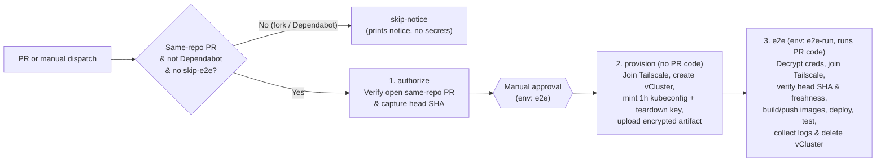

# E2E vCluster CI Workflow

This document explains how [`.github/workflows/e2e.yml`](../.github/workflows/e2e.yml) runs end-to-end tests in CI using throwaway [vClusters](https://www.vcluster.com/) on vCluster Platform, reached over Tailscale.

For what the E2E scenario itself deploys and tests (and how to run it locally with `kind`), see [`e2e/README.md`](../e2e/README.md) and [`e2e/litellm_chatbot_to_catalog_api/README.md`](../e2e/litellm_chatbot_to_catalog_api/README.md). For the full threat model and ownership details, see **ADR-012** in [`naira-project/architecture`](https://github.com/naira-project/architecture/tree/main/adr).

## Overview

Instead of spinning up a local `kind` cluster on the GitHub Actions runner, CI provisions a fresh, isolated vCluster on vCluster Platform for each run, deploys the scenario into it, runs the Go E2E assertions, and deletes the vCluster when done.



## When the workflow runs

- **Pull requests (automatic):** Runs on PRs that change `catalog/**`, `plugins/**`, `e2e/**`, `go.mod`, `go.sum`, `mise.toml`, or `.github/workflows/e2e.yml`.
- **Opting out:** Add the `skip-e2e` label to a PR to skip the workflow.
- **Forks and Dependabot:** Fork PRs and `dependabot[bot]` PRs do not receive secrets. `authorize`, `provision`, and `e2e` are skipped, and `skip-notice` posts a notice explaining why.
- **Manual dispatch:** A maintainer can trigger a run manually via **Actions -> E2E -> Run workflow** with a `pr-number` (this also works for Dependabot PRs, as long as the branch is in this repo).
- **Concurrency:** Runs are grouped per PR (`E2E-<pr-number>`) with `cancel-in-progress: true`, so pushing a new commit cancels the previous run for that PR without affecting other PRs.
- **One approval per run:** Only `provision` requires manual approval (via the `e2e` GitHub environment). Once approved, `e2e` runs automatically in the `e2e-run` environment without a second approval.

## Why there are three jobs (security boundary)

GitHub loads a job's secrets into the runner process, where any untrusted PR code executed later in that same job could read them. To keep the long-lived `VCLUSTER_PLATFORM_ACCESS_KEY` away from PR code, the workflow separates **trusted setup** from **PR code execution**:

| Job | GitHub Environment | Approval | Runs PR code? | Has platform access key? |
|---|---|---|---|---|
| `authorize` | none | No | No | No |
| `provision` | `e2e` | Yes | No | Yes |
| `e2e` | `e2e-run` | No | Yes | No (1h run-scoped creds only) |

## Step-by-step walkthrough

### 1. `authorize`

Runs inline (without checking out the PR) and calls the GitHub API (`gh api`) to verify:

1. `pr-number` is a valid positive integer.
2. The PR is **open**.
3. The PR head repository is **this repository** (not a fork).

It outputs `pr-number` and the exact `head-sha` it saw so the `e2e` job can verify nothing changed after approval.

### 2. `provision`

Runs with the `e2e` environment after maintainer approval, still without checking out PR code:

1. **Compute identifiers:** Builds a DNS-1123 `ENV_ID` formatted as `pr-<pr-number>-<run-id>-<run-attempt>`. Including the attempt keeps re-runs clear of any leftover vCluster.
2. **Install `vcluster` CLI:** Downloads a pinned version (`v0.37.5`, verified with SHA-256) rather than reading `mise.toml` from PR code.
3. **Join Tailscale:** Connects the runner to the tailnet as `tag:ci` using GitHub OIDC (`id-token: write`) so it can reach vCluster Platform.
4. **Create the vCluster:** Logs in to vCluster Platform (`--docker-login=false` to avoid writing `~/.docker`) and creates the vCluster from template `vcluster-e2e-template` in project `e2e` (`--connect=false` so the platform key is not written into the kubeconfig).
5. **Mint two 1-hour, single-vCluster credentials:**
   - **Kubeconfig:** Generated via `vcluster platform connect vcluster` using a service account token (`kube-system/naira-e2e`, `cluster-admin`, 1h TTL).
   - **Teardown key:** An `OwnedAccessKey` (`management.loft.sh/v1`, 1h TTL) created via `kubectl create --raw` (the scoped CI key does not have API discovery permissions). Its scope allows only logging in (`loft-cli`), reading project `e2e`, and getting/deleting this exact `VirtualClusterInstance`.
   - A sanity check verifies that neither file contains `VCLUSTER_PLATFORM_ACCESS_KEY`.
6. **Encrypt and upload credentials:** Packs both files into a tarball, encrypts it with AES-256-CBC + PBKDF2 using `E2E_CREDENTIALS_KEY`, and uploads it as the `e2e-credentials` artifact (1-day retention). Encryption is required because GitHub Actions artifacts are readable by anyone with repository read access.

### 3. `e2e`

Runs in `e2e-run` right after `provision` succeeds:

1. **Prepare teardown first:** Before checking out any PR code, the job downloads and decrypts `e2e-credentials`, installs the pinned `vcluster` CLI, and joins Tailscale. This ensures the final `Delete vCluster` step still works even if checkout or the SHA check fails.
2. **Checkout and verify head SHA:** Checks out `refs/pull/<pr-number>/merge` (`fetch-depth: 2`, `persist-credentials: false`) and checks that `HEAD^2` matches `authorize`'s `head-sha`. If someone pushed to the PR after approval, the job stops immediately.
3. **Tag images by merge commit:** Sets `TAG` to the merge commit SHA (`HEAD`) so container images cached on EKS nodes are never shared across PRs.
4. **Install toolchain and check freshness:** Sets up Go 1.26 and installs `kubectl` and `helm` from `mise.toml`. Verifies the vCluster was provisioned less than 10 minutes ago (`age <= 600s`) so the 1-hour credentials will not expire mid-run.
5. **Build, push, and deploy:** Logs in to GHCR (`ghcr.io/naira-project/naira-e2e` using `GITHUB_TOKEN` with `packages: write`) and runs:
   ```bash
   ./e2e/scripts/create-environment.sh \
     --scenario litellm_chatbot_to_catalog_api \
     --env-id "${ENV_ID}" \
     --tag "${TAG}" \
     --context "${ENV_ID}" \
     --registry
   ```
   This builds the scenario's images, pushes them to GHCR, deploys them into namespace `${ENV_ID}` inside the vCluster, waits for rollouts, and runs the seed job.
6. **Port-forward and run assertions:** Opens `kubectl port-forward` tunnels to `svc/catalog` (`8090`) and `svc/keycloak` (`8080`) through the vCluster Platform proxy, waits until both respond, and runs:
   ```bash
   go test -tags e2e -v -timeout=5m ./e2e/litellm_chatbot_to_catalog_api/assert/...
   ```
7. **Collect diagnostics (`if: always()`):** Dumps pods, services, container logs, events, and `kubectl describe pods` for namespace `${ENV_ID}`.
8. **Delete vCluster (`if: always()`):** Logs in with the scoped teardown key and deletes the vCluster. Deleting the vCluster removes the entire E2E environment (`e2e/scripts/destroy-environment.sh` is for local `kind` clusters only).

## Cleanup and failure handling

The workflow has multiple layers of cleanup so throwaway vClusters do not leak:

| Failure point | How the vCluster gets cleaned up |
|---|---|
| Inside the `Provision vCluster` step | Bash `trap cleanup EXIT` deletes the vCluster using the platform access key. |
| After provisioning, still in `provision` (e.g., encrypt/upload fails) | `Delete vCluster on failure` step deletes it using the platform access key. |
| Anywhere in `e2e` (including checkout or SHA check failures) | `Delete vCluster` (`if: always()`) deletes it using the teardown key. It intentionally fails if delete fails rather than ignoring "not found", because `vcluster` reports the same error when a key lacks permission. |
| Run cancelled before `e2e` starts (or teardown fails) | The vCluster template's **2-hour inactivity auto-delete** removes it automatically. |

## Environments, secrets, and variables

| Name | Type | `e2e` | `e2e-run` | Purpose |
|---|---|---|---|---|
| `VCLUSTER_PLATFORM_ACCESS_KEY` | Secret | Yes | No | Creates vClusters and mints per-run teardown keys |
| `E2E_CREDENTIALS_KEY` | Secret | Yes | Yes | Encrypts/decrypts the `e2e-credentials` artifact |
| `VCLUSTER_PLATFORM_URL` | Variable | Yes | Yes | vCluster Platform endpoint (reached over Tailscale) |
| `TS_E2E_OAUTH_CLIENT_ID` | Variable | Yes | Yes | Tailscale OAuth client ID for `tag:ci` |
| `TS_E2E_AUDIENCE` | Variable | Yes | Yes | GitHub OIDC audience for Tailscale federation |

## What approvers should check

Approving the `e2e` environment starts both `provision` and `e2e` (which runs PR code). Before approving:

- Check whether the PR modifies `.github/workflows/e2e.yml` — edits to the workflow file run with the `e2e` environment's identity once approved.
- Review any changes under `e2e/`, `catalog/`, or `plugins/` that will execute during the `e2e` job (which has `packages: write` to `ghcr.io/naira-project/naira-e2e`, access to `E2E_CREDENTIALS_KEY`, Tailscale `tag:ci` ingress access, and the run's 1h vCluster kubeconfig/teardown key).

## Common issues when re-running

- **`PR head moved to ... after authorization`:** New commits were pushed after `authorize` ran. Choose **Re-run all jobs** (not "Re-run failed jobs").
- **`vCluster was provisioned ...s ago; its credentials would expire mid-run`:** Re-running only `e2e` after >10 minutes is blocked because the 1h credentials could expire mid-test. Choose **Re-run all jobs** to provision a fresh vCluster.
- **Dependabot PR didn't run E2E:** Trigger the workflow manually with **Actions -> E2E -> Run workflow** and enter the PR number.
